# Лабораторная работа 7

Навигация и адаптивный интерфейс

**Выполнил:** Солдатов Владимир Сергеевич  
**Город:** Кемерово  
**Дата:** 6 ноября 2026 года

Отчёт о практической части и контрольных заданиях. Ниже приведены реализация, результаты проверок и настоящие снимки экранов эмулятора.

## Цель и выполненные задания

Цель — реализовать переходы между экранами Jetpack Compose и адаптировать навигацию и содержимое к размеру окна. Выполнены практические приложения Cupcake и Reply и контрольные приложения Lunch Tray и My City.

| Модуль | Результат |
| --- | --- |
| cupcake | Переходы между количеством, вкусом, датой и итогом заказа |
| reply | Нижняя навигация, Navigation Rail, постоянная панель и макет список-подробности |
| lunchtray | Пять экранов заказа, возврат, отмена и завершение |
| mycity | 15 мест Кемерова в пяти категориях, локальные фотографии и адаптивные макеты |

### Jetpack Navigation

NavHost связывает маршрут с экраном, NavController выполняет переходы и управляет стеком. Текущий маршрут определяет заголовок AppBar. Кнопка возврата отображается, если в стеке есть предыдущий экран. Отмена очищает состояние заказа и возвращает к началу.

### Классы размеров окна

Для узкого окна применяется нижняя панель навигации. Для среднего окна используется вертикальная Navigation Rail. На широком окне размещается постоянная боковая панель; список и подробности показываются одновременно. Решение зависит от ширины окна, а не от названия устройства.

## Cupcake и схема переходов

```kotlin
Start → Flavor → Pickup → Summary
Назад: возврат на предыдущий экран
Cancel: сброс заказа и переход к Start
Send: открытие системного интерфейса отправки
```

Перечисление CupcakeScreen содержит Start, Flavor, Pickup и Summary со строковыми ресурсами заголовков. AppBar получает текущий экран из back stack. Начальный экран не содержит кнопку возврата. Экраны выбора вкуса и даты используют общий компонент SelectOptionScreen.

| Первый экран | Второй экран |
|:---:|:---:|
| 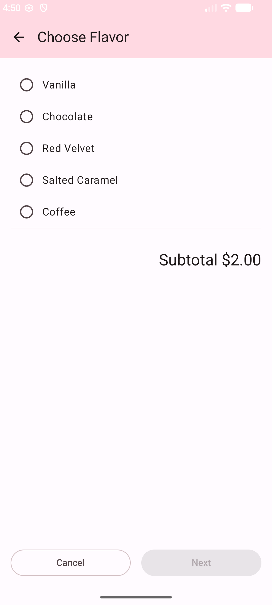 | 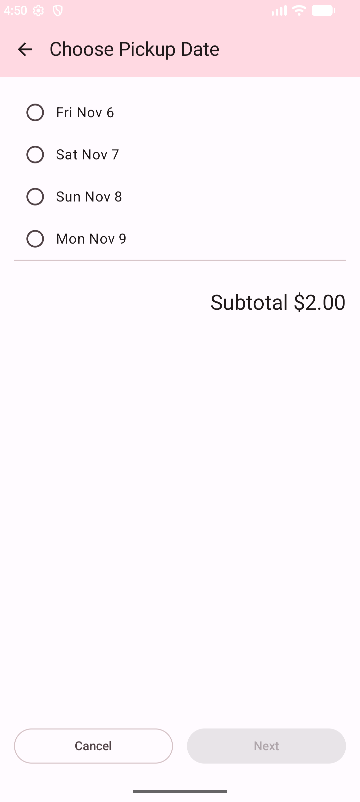 |

*Рисунок 1 — Выбор вкуса и даты получения заказа*

## Итог заказа Cupcake и отмена

| Первый экран | Второй экран |
|:---:|:---:|
| 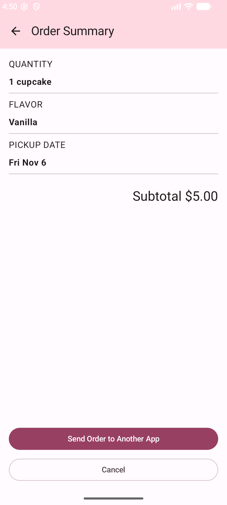 | 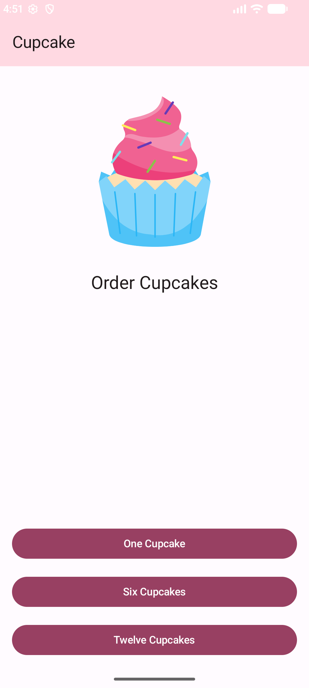 |

*Рисунок 2 — Итог заказа и возврат на начальный экран после отмены*

Состояние заказа хранится в OrderViewModel. Сумма пересчитывается при выборе количества и даты. Отмена вызывает сброс данных и удаляет промежуточные экраны из стека. Формирование ACTION_SEND предусмотрено кодом; сообщения внешним получателям в ходе проверки не отправлялись.

## Проверка навигации Cupcake

Выполнены 14 инструментальных тестов. Проверены начальный маршрут, отсутствие кнопки возврата в начале, переходы вперёд, обратная навигация, Cancel на промежуточных экранах и отображение итоговых данных.

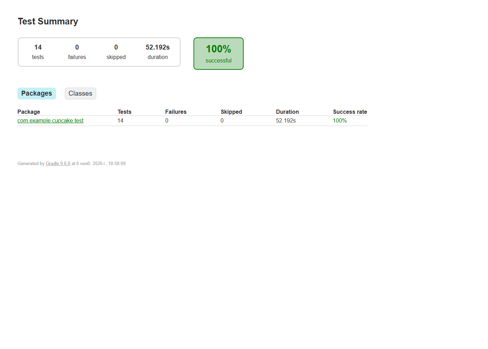

*Рисунок 3 — Результат 14 тестов интерфейса и навигации*

Проверки экрана выбора также подтверждают доступность перехода при выбранной опции и корректное отображение содержимого итогового экрана.

## Reply на телефоне

На узком экране Reply показывает список писем и нижнюю навигацию. При выборе письма открывается отдельный экран подробностей; кнопка возврата возвращает к списку. Выбранная вкладка и письмо принадлежат ReplyViewModel.

| Первый экран | Второй экран |
|:---:|:---:|
| 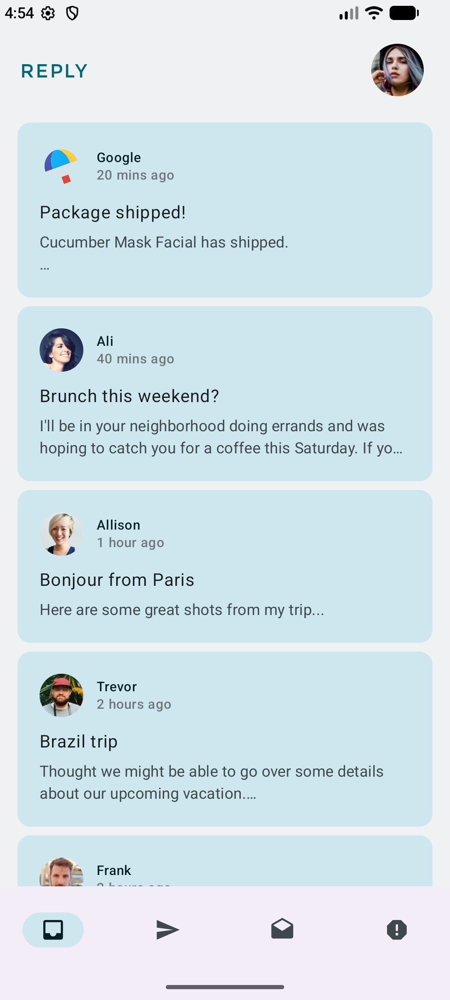 | 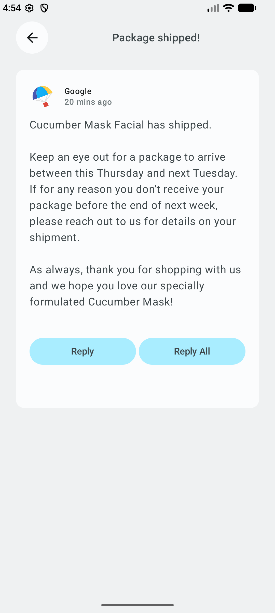 |

*Рисунок 4 — Список писем и отдельный экран подробностей*

## Reply на среднем экране

При среднем размере окна нижняя панель заменяется Navigation Rail. Контент остаётся однопанельным. Переключение вкладок меняет текущий почтовый ящик и сбрасывает состояние подробного просмотра.

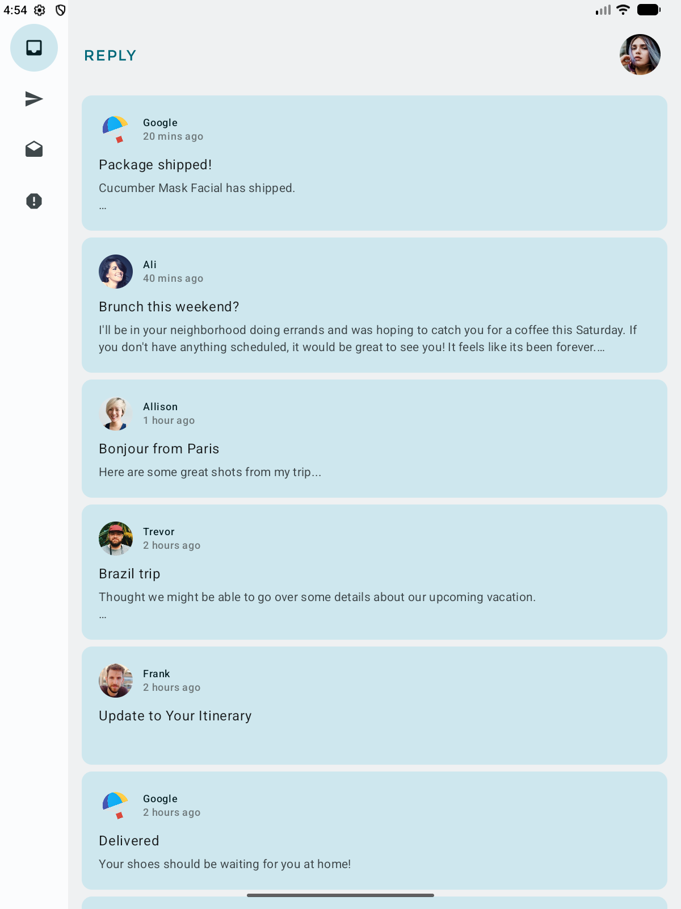

*Рисунок 5 — Navigation Rail при ширине 800 dp*

## Reply на широком экране

На широком окне используется постоянная навигационная панель и две области: список и подробности выбранного письма. Вложенный экран подробностей не показывает лишнюю кнопку возврата и повторный заголовок, а отступы задаются с учётом размещения внутри общего макета.

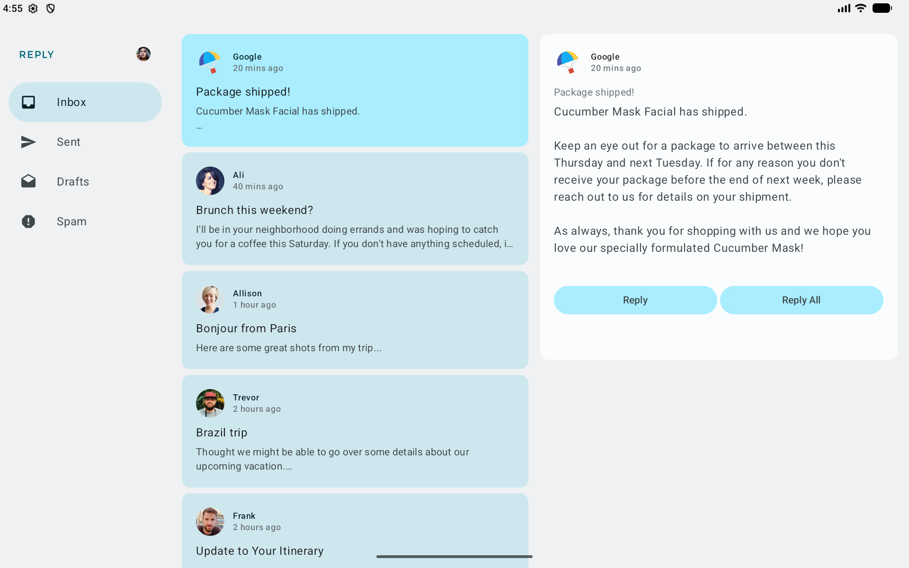

*Рисунок 6 — Постоянная панель и макет список-подробности*

Проверка выполнялась на том же эмуляторе с изменённым размером окна: 1920 × 1200 пикселей при плотности 240 dpi, то есть около 1280 × 800 dp. Это эмуляция размера планшета, а не проверка на отдельном физическом устройстве.

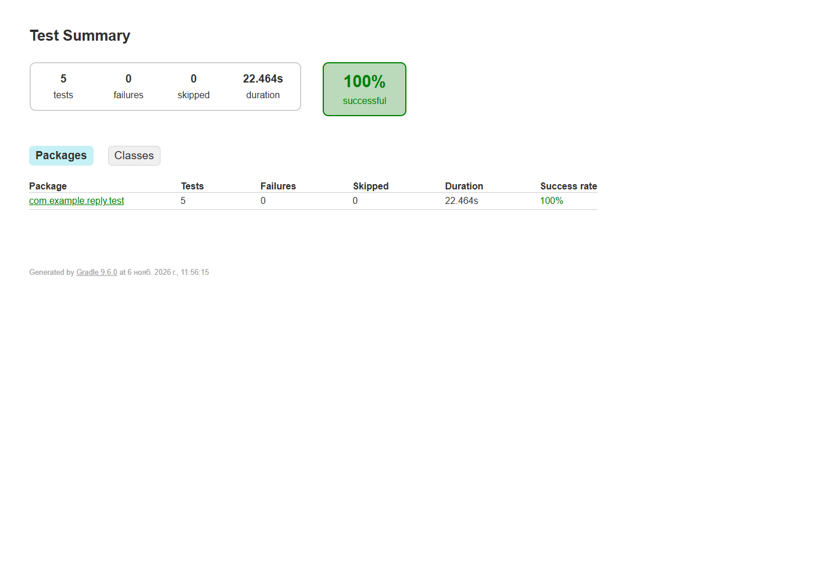

*Рисунок 7 — Тесты вариантов навигации и сохранения выбранного письма*

## Lunch Tray и оформление заказа

```kotlin
Start → Entree → SideDish → Accompaniment → Checkout
Submit: сброс заказа и возврат к Start
Cancel на любом этапе: сброс заказа и возврат к Start
```

Перечисление LunchTrayScreen связывает пять экранов с заголовками из ресурсов. На каждом шаге выбирается позиция меню. OrderViewModel пересчитывает стоимость выбранных позиций, налог и итоговую сумму. Повторный выбор в одной категории заменяет предыдущую позицию, а не добавляет её повторно.

| Первый экран | Второй экран |
|:---:|:---:|
| 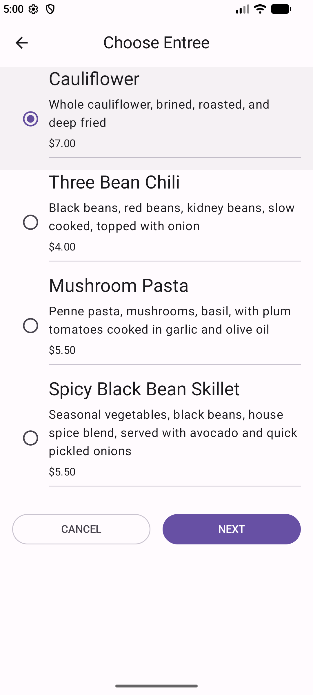 | 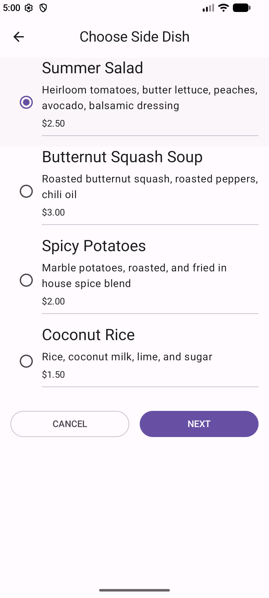 |

*Рисунок 8 — Основное блюдо и гарнир*

## Lunch Tray и завершение заказа

| Первый экран | Второй экран |
|:---:|:---:|
| 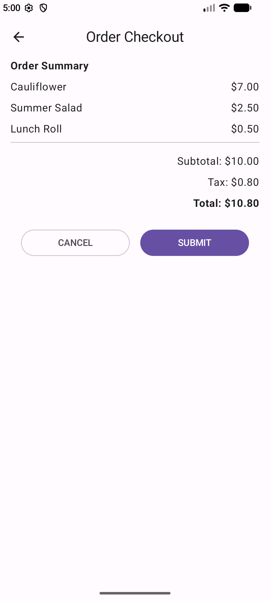 | 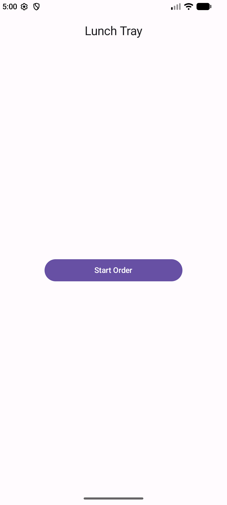 |

*Рисунок 9 — Подтверждение заказа и возврат на стартовый экран*

Проверены переходы через все три категории, итоговый экран, Submit и Cancel на каждом из четырёх экранов после старта. На начальном экране обратная навигация недоступна; на последующих экранах AppBar предоставляет возврат.

## My City про Кемерово

В приложении представлены пять категорий по три места. Модели и локальный поставщик данных находятся в пакете data; состояние и обработчики событий — в CityViewModel; Compose-компоненты читают состояние и вызывают обработчики. Маршруты Jetpack Navigation открывают список категории и подробности места.

| Категория | Места |
| --- | --- |
| Рестораны | Port 42; Забой; Волна |
| Парки | Парк Чудес; Парк Антошка; Берёзовая роща |
| Кофейни | PORT coffee; КофеБулка; Coffeeman |
| Кинотеатры | Космос; STARMAX cinema; Планета Кино Променад 3 |
| Торговые центры | Променад 2; Променад 3; Летосити |

Названия, адреса, описания и ссылки хранятся в строковых ресурсах; фотографии — в drawable. Для просмотра содержимого сеть не нужна. Кнопка «Подробнее о месте» открывает сайт источника по явному действию пользователя. На карточке «Планета Кино Променад 3» используется фотография здания комплекса, что указано в описании.

Полный список источников сведений и изображений находится в SOURCES.md в корне репозитория. Данные проверены при подготовке работы; актуальное расписание и условия посещения следует уточнять у организаций.

## My City на телефоне

| Первый экран | Второй экран |
|:---:|:---:|
| 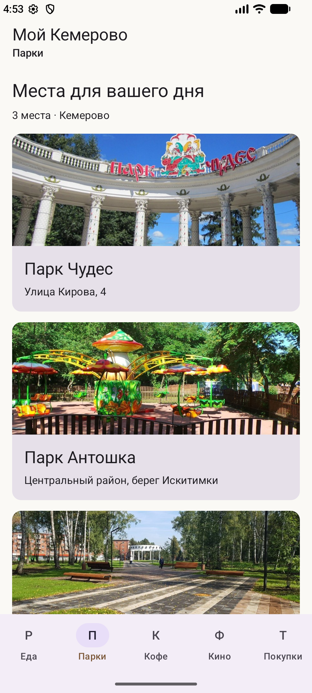 | 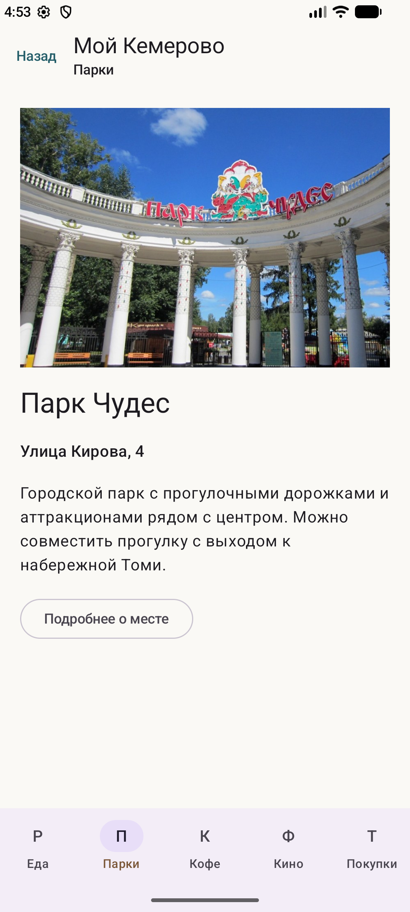 |

*Рисунок 10 — Категория парков и подробности Парка Чудес*

Нижняя панель позволяет сменить категорию. Нажатие на карточку открывает подробности с фотографией, адресом и описанием. Возврат закрывает подробности и показывает список выбранной категории.

## Адаптивность My City

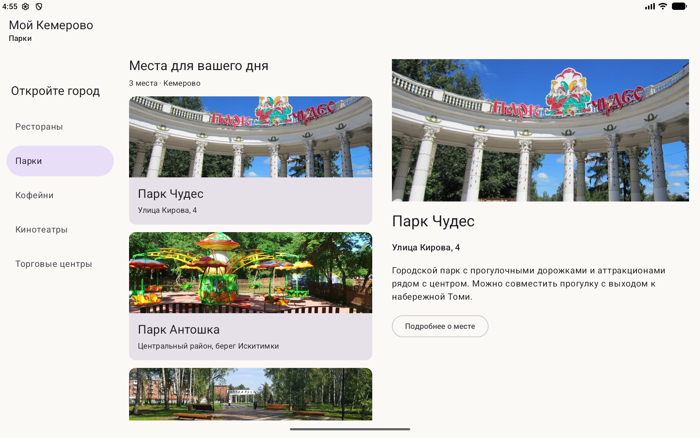

*Рисунок 11 — На широком экране список и подробности расположены рядом*

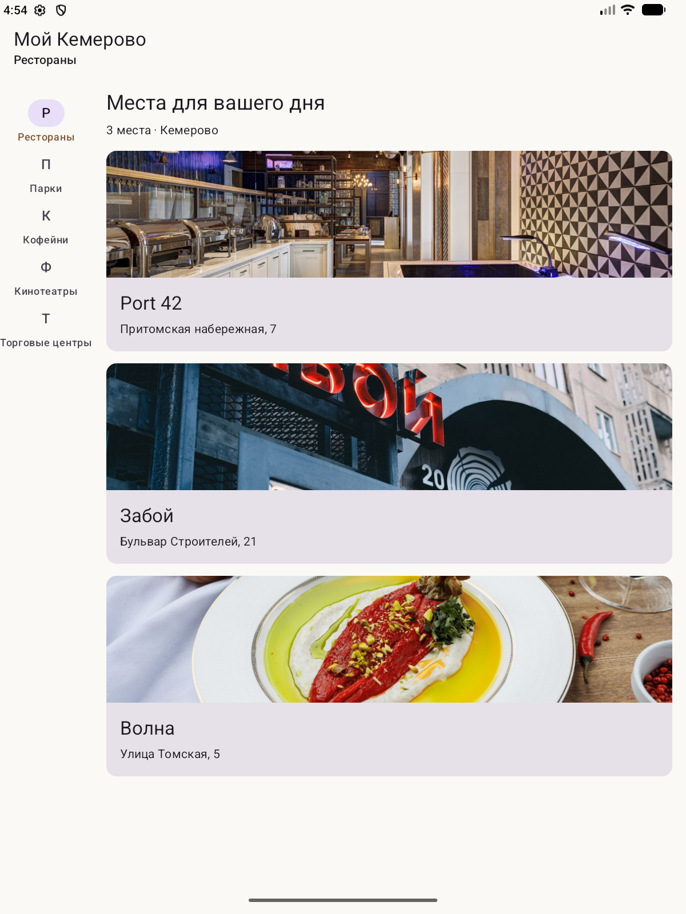

*Рисунок 12 — Средний экран с Navigation Rail*

## Автоматизированная проверка My City

Два модульных теста проверяют уникальность 15 идентификаторов, наличие трёх мест в каждой категории и изменение выбранной категории и места. Инструментальный тест открывает место, пересоздаёт Activity, проверяет сохранение выбора и последовательно переключает остальные категории. Для широкого окна дополнительно проверяется отсутствие кнопки возврата внутри двухпанельного макета.

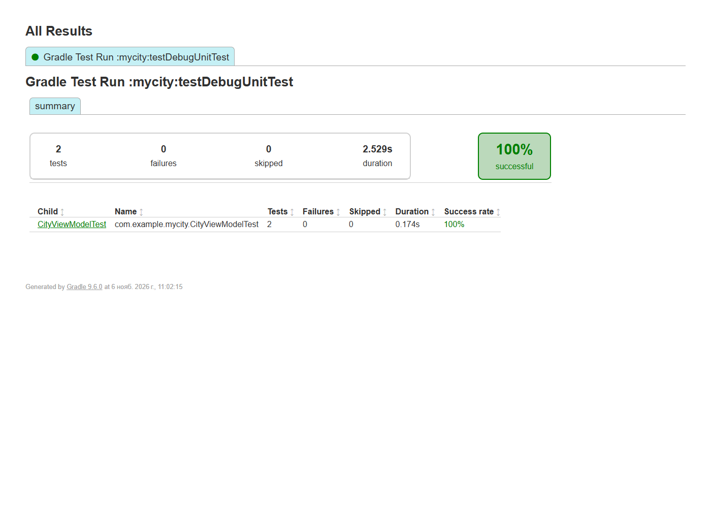

*Рисунок 13 — Модульные тесты CityViewModel и набора данных*

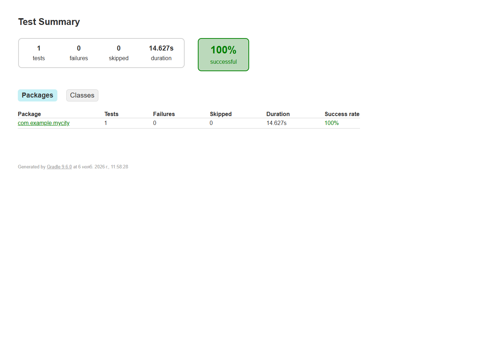

*Рисунок 14 — Проверка категорий, подробностей и пересоздания Activity*

## Выводы и воспроизведение

В приложениях реализованы навигационные графы и обработка стека экранов. Заголовки AppBar соответствуют текущему маршруту, а отмена возвращает к началу с очисткой состояния. Reply и My City используют три варианта навигации в зависимости от ширины окна. На широком экране список и подробности одновременно используют доступное пространство. Выбранные данные сохраняются при пересоздании Activity благодаря ViewModel.

### Порядок проверки

Открыть корневую папку этого репозитория в Android Studio, синхронизировать Gradle, выбрать нужный модуль и запустить на эмуляторе. Команды сборки и тестов приведены ниже. Готовые APK появятся в `<модуль>/build/outputs/apk/debug/`. Скриншоты находятся в `docs/images`, сводка тестов — в `docs/test-summary.json`.

### Основные источники

Методические указания к лабораторной работе 7, предоставленные в файле Laboratornaja+rabota+7.docx.

Навигация Compose: https://developer.android.com/develop/ui/compose/navigation

Адаптивный интерфейс: https://developer.android.com/develop/ui/compose/layouts/adaptive

Исходники учебных проектов Google: https://github.com/google-developer-training

Туристический портал Кемерова: https://visit-kemerovo.ru/

Культура РФ — сведения о STARMAX: https://www.culture.ru/institutes/78692/kinoteatr-starmax-cinema

Сведения о заведениях и фотографии: официальные сайты организаций; полный перечень в SOURCES.md.

## Как открыть и запустить

Откройте корневую папку репозитория в Android Studio. После синхронизации выберите один из модулей: `cupcake`, `reply`, `lunchtray`, `mycity`.

Среда исходной проверки: JBR OpenJDK 25.0.3, Gradle 9.6.0, Android Gradle Plugin 9.4.1, Android SDK 37.0, Android Emulator с API 37. Минимальная версия Android — API 24. Локальный путь к SDK создаётся Android Studio в `local.properties` и не хранится в Git.

```powershell
.\gradlew.bat assembleDebug testDebugUnitTest
.\gradlew.bat :cupcake:connectedDebugAndroidTest
.\gradlew.bat :mycity:connectedDebugAndroidTest
```

### Тесты Reply на широком экране

Полный набор исходных тестов Reply требует широкого окна. Для работающего эмулятора выполните:

```powershell
adb shell wm size 1920x1200
adb shell wm density 240
.\gradlew.bat :reply:connectedDebugAndroidTest
adb shell wm size reset
adb shell wm density reset
```

Изменение размеров проверяет конфигурации одного эмулятора; отдельные физические устройства в проверке не использовались.

## Сводка тестов

Модульные тесты: **2**, инструментальные: **20**. Все перечисленные тесты прошли. Результаты: [docs/test-summary.json](docs/test-summary.json).

## Атрибуция

[Источники сведений и изображений](SOURCES.md) · [Учебные проекты и лицензии](THIRD_PARTY_NOTICES.md).
